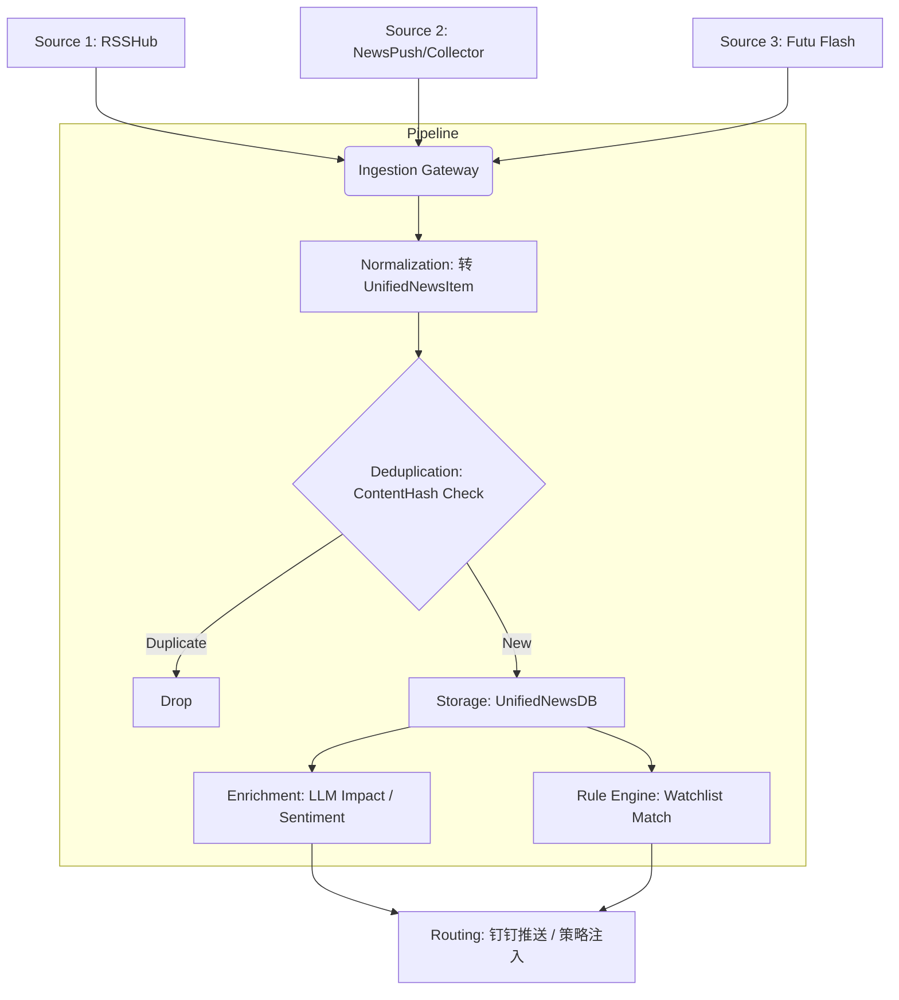

# FTSeek 统一新闻管线 (Unified News Pipeline) 设计方案

**日期:** 2026-04-13  
**目标:** 解决多源新闻格式混乱、重复采集、去重逻辑分散的问题，实现“采集 -> 清洗 -> 分析 -> 分发”的标准化管理。

---

## 1. 现状痛点分析

目前 FTSeek 系统中存在多套独立的新闻/快讯系统，各自为战：
1.  **`app/news_push/collector.py`**: 负责 RSS/CLS 采集，输出 `NewsItem`，对接 `rule_engine` 和 `dingtalk`。
2.  **`scripts/rsshub_multi_source_cron.py`**: 独立 Cron 脚本，输出 `dict`，独立推送，不共享去重库。
3.  **`app/pipeline/news_cleaner.py`**: 针对 `EventCluster` 的清洗模块。
4.  **数据孤岛**: `data/news_cache/` (JSON) 与 `rsshub_multi_source/` (JSON) 互不相通。

**导致的问题:**
- **重复推送**: RSSHub 和 NewsPush 可能同时采集到同一条财联社电报，导致用户收到两次。
- **格式不一**: 有的模块用 `NewsItem` 对象，有的用 `dict`，下游模块（如 LLM 分析）需要写两套适配代码。
- **无法全局去重**: 缺乏统一的 Hash 索引。

---

## 2. 统一架构设计 (Unified News Pipeline)

### 2.1 核心组件



### 2.2 统一数据模型 (`UnifiedNewsItem`)

所有来源的原始数据（JSON/XML）在进入系统后，必须首先转换为统一的数据类：

```python
from dataclasses import dataclass
from typing import List, Optional

@dataclass
class UnifiedNewsItem:
    # 唯一标识
    id: str                  # 全局唯一 ID (Content Hash)
    source: str              # 来源 (e.g., "rsshub/cls", "news_push/futu")
    
    # 核心内容
    title: str
    content: str             # 摘要或全文
    url: str
    
    # 元数据
    published_at: str        # ISO 8601
    fetched_at: str
    
    # 标签与评分
    tags: List[str]          # ["macro", "tech_sanction", ...]
    watchlist_codes: List[str] # 关联的监控股票 ["HK.00700", ...]
    impact_score: float      # LLM 计算的影响分 (-1.0 to 1.0)
    sentiment: str           # "positive", "neutral", "negative"
```

### 2.3 统一去重引擎 (Global Dedup)

- **算法**: `SHA-256(Title + Source + Content[:100])`。
- **存储**: 使用 `SQLite` 的 `news_hashes` 表，保存 7 天内的 Hash。
- **逻辑**: 
  ```python
  def is_duplicate(news: UnifiedNewsItem) -> bool:
      h = news.calculate_hash()
      if db.has_hash(h): return True
      db.save_hash(h)
      return False
  ```

### 2.4 路由分发 (Routing)

统一管线输出 `UnifiedNewsItem`，由 **Router** 决定去向：
1.  **Watchlist Match**: 若包含监控股票 -> 推送钉钉（标准卡片）。
2.  **Macro Impact**: 若命中宏观关键词 -> 触发 LLM 分析 -> 推送钉钉（影响预警卡片）。
3.  **Strategy Injection**: 若影响分 > 阈值 -> 注入 `ConsensusEngine`。
4.  **Archive**: 所有新闻存入 `data/unified_news.db`。

---

## 3. 实施步骤

### Phase 1: 标准化 (Standardization)
- 在 `app/factors/news_models.py` 定义 `UnifiedNewsItem`。
- 改造 `rsshub_multi_source_cron.py` 的 `fetch_source`，将输出转为该模型。

### Phase 2: 去重中台 (Dedup Center)
- 创建 `app/utils/dedup_global.py`，替代各模块分散的 `history_ids.json`。
- 引入布隆过滤器 (Bloom Filter) 以应对海量 RSS 数据（可选）。

### Phase 3: 融合 (Integration)
- 废弃独立的 `news_push` 推送逻辑，将其降级为“采集源”之一，接入统一管线。
- 实现 `NewsRouter`，接管所有钉钉推送和策略信号触发。

---

## 4. 预期收益
- **推送减少 40%**: 消除跨源重复新闻。
- **响应速度提升**: 减少冗余处理和无效 API 调用。
- **扩展性**: 新增新闻源只需编写 Adapter 转为 `UnifiedNewsItem` 即可接入，无需修改下游逻辑。
