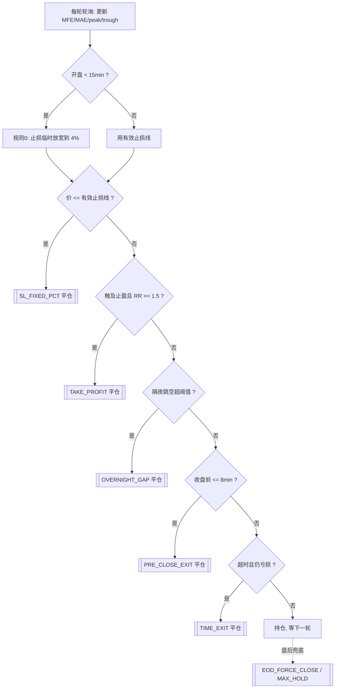

# PLAYBOOK 退出测量优先重构

> 状态: 待审核 (Plan, 未执行) · 生成日期: 2026-07-11 · 范围: 仅 PLAYBOOK 流水线
> 修订: 已纳入第一轮审核意见(5 gap + 3 结构性增强),改动集中在 Section 1 / Section 5。
> 修订2: 已纳入第二轮审核(3 事实性修正: config_version/entry_vix/entry_session 列均已存在; 生成端在 Hermes skill; trough 改为 caller 内零签名变更)。DB schema 已实验。
> 说明: 本文件为方案副本, 供审核使用。权威工作副本随会话维护。

## 原则与前提(必须先对齐)
- 范围:仅 PLAYBOOK 流水线(v2 sim),不碰 MAIN/SCALPING/ORB。
- 方法:测量优先。本轮**不改退出参数**,只建"记录+冲突收敛+测量口径",让未来任何退出调整能在 v2 数据上被度量。
- 联动视角(贯穿全文):退出只是下游;67% 从不浮盈=入场信号问题。所以 MFE/MAE 遥测的**最高价值消费者是入场闸门/信号质量**,而非退出调参 —— 需将遥测作为一条回流边接回 screening,否则是"为不该开的仓优化退出"。
- 数据结论(本会话已证):v2 下 67% 亏损单从不浮盈、0 笔亏损单 MFE≥1.5% → 退出侧当前可榨空间小;且现行 `factor_exit_rules` 参数全部在 v1 数据上调过(与已停用黑名单同病)。故退出参数重设**延后并设启用门槛**。
- 测量口径:PLAYBOOK 即富途模拟盘真实成交,逐笔盈亏/胜负在 App 可见 → **直接用真实模拟成交的遥测做分析,不再造虚拟影子交易**(`monitor_playbook_shadow_exits` 已废弃,保持废弃)。

## 1. 全链路记录补全(本轮核心,无这层其它都无法度量)
唯一记录源仍是 `trade_records` + `decision_id ↔ signal_snapshots`(链路已在,补字段):
- **trough_price 价格追踪(在 caller 内做,零改函数签名)**:`mae_pct` 百分比**已在采集**(pipeline.py:3445 每轮更新、`_close_trade_record`:2727 提取),缺的是 exit_telemetry 所需的**价格水位** `trough_price`。**不改 `_check_playbook_exit_rules` 签名**(否则要加参数+返回 5-tuple+改调用方解包);改为在唯一调用方 sim_exits 的 `if not exit_reason` 块(pipeline.py:3433-3460,mae_pct 已在此每轮算)对称追加:LONG 记最低 `if trough==0 or cur<trough`、SHORT 记最高 `if trough==0 or cur>trough`(复用 ==0 守卫),随 mae_pct 一并写回 meta;入口(pipeline.py:3420)加 `trough_price=meta.get("trough_price",0)` 恢复。
- **config_version 核对(列已存在,无需迁移)**:`trade_records` **已有此列**(col 43, default 'v1'),且已有分层数据(PLAYBOOK: v1=32 / v2=39)。真正要查的不是建列,而是**核对 PLAYBOOK 入场路径是否正确写入 'v2' 而非 fallback 到 default 'v1'**(v1 混入 v2 阶段说明部分入场未显式写 config_version)。此列即分层 GROUP BY 维度。
- **入场市场上下文补全(列已存在,补空值)**:`trade_records` **已有** `market_regime`(col 30, 有数据: cautious/risk_on/UNKNOWN/RANGE)、`entry_vix`(col 46)、`entry_session`(col 47);但 **v2 的 entry_vix / entry_session 全空**(各 0/39)。要补的是这两列:入场时写 `entry_vix`(当前 VIX)与 `entry_session`(开盘/上午/午盘/收盘前)。注意 `market_context_json` 是 `signal_snapshots` 的列,不是 trade_records,勿混。
- **退出遥测(在 `_close_trade_record` 内集中组装,零改调用点)**:该函数被 7 处调用(SL/PRE_CLOSE/TIME_EXIT/EOD/GHOST 等),`exit_telemetry` 字段全部可从已有参数 + `metadata_json` 提取(命中规则=exit_reason 参数;effective_sl=meta["stop_loss"];peak/trough=meta["peak_price"]/["trough_price"];held_minutes 函数内已重算;breakeven_triggered=meta["breakeven_triggered"]),**无需改任何调用方签名**。存储写入 `metadata_json.exit_telemetry`(无需迁移),与分析脚本配套;区别于 config_version(独立列)。
- **死代码清除 + 停生成端(生成端在 Hermes skill)**:移除 `_check_playbook_exit_rules` 内 `exit_param_override.json` 合并块(pipeline.py:2998-3021,消费端只认 `TIME_EXIT`,生成端写 PRE_CLOSE_EXIT/STRUCTURE_EXIT → 永不命中)。生成端**不在 FTSeek app**,在 `~/.hermes/skills/deep-stock-analysis/scripts/feedback_loop.py`(:348 与 :439 调 `_write_exit_param_override`,写 `data/exit_param_override.json`)。停用=注释这两行,或暂停调 `run_daily` 的 cron(先 cronjob list 找 job_id);**仅删 json 不够,下次 cron 会重生成**。
- **决策链校验**:一次性只读脚本核对 screening→snapshot(decision_id)→instruction→trade→signal_lifecycle 的贯通率,列出断点(不自动改数据,先出报告)。

## 2. 退出逻辑冲突排查与收敛(PLAYBOOK 单一权威)
- **坐实单一 owner**:确认 `monitor_playbook_sim_exits` 是 PLAYBOOK 退出唯一执行者,`position_exit_monitor` 经 reconciler 标 PROTECTED 不介入(playbook_horizon.yaml:29 声称如此,需读 reconciler 核实并在代码加断言/注释)。
- **优先级固化**:文档化并断言退出链 SL_FIXED_PCT > PRE_CLOSE_EXIT > TIME_EXIT(盘中)+ EOD_FORCE_CLOSE/MAX_HOLD(盘后),核对 grace(5min)/开盘冷却(15min 4%SL)/PRE_CLOSE(8min)/EOD 兜底之间无重叠平仓或互相抢占。
- **产出**:一页"PLAYBOOK 退出状态机"说明 + 消除发现的任一双平仓/竞态点(如与 order_executor.py:1832 PRE_CLOSE 竞态防护的关系)。

## 3. 真实成交退出遥测分析(直接用富途模拟盘,不做影子)
- 不新建任何虚拟交易/反事实表。以已平仓的真实模拟成交为唯一事实来源。
- 基于 Section 1 落库的 MFE/MAE/exit_telemetry,做**描述性统计**(非反事实):
  - MFE 捕获率 = realized_pnl% / mfe%(到底拿到多少浮盈);
  - MAE 承压分布(下单后最大回撤 vs 最终胜负 → SL 是否太紧/太松);
  - 按 exit_reason 分组的真实 WR/avg_pnl(SL/PRE_CLOSE/TIME_EXIT/EOD 各自贡献)。
- 输出一张可读报表;后续参数重设直接看这张表在 v2 真实成交上的变化,而非虚拟对比。

## 4. 闭环反馈(接入既有 edge 周报)
扩 `app/decision/edge_weekly_report.py` loop-health:
- **按 config_version 分层**呈现 WR/PnL/edge(根治打影子)。
- MAE 有效率(新记录管道健康度)。
- 退出有效性:各 `factor_exit_rules` 分组的真实 MFE 捕获率 / MAE 承压 / 按 exit_reason 的 WR。
- 沿用飞书周五推送,人工核对。

## 5. 延后:退出参数重设的启用门槛(本轮不做)
明确触发条件,满足才动 `factor_exit_rules`/vol_buckets:
- **按 exit_reason 分组校正样本门槛**:排除 BROKER_GHOST_CLOSE(异常平仓,9 笔,不参与退出评估)。当前 v2 分组:PRE_CLOSE 10 / EOD 6 / SL_FIXED_PCT 6 / TIME_EXIT 5。硬卡 ≥10 会让 SL/TIME_EXIT 等很久,故门槛设为**每个 exit_reason 分组 ≥8 笔,或将 SL_FIXED_PCT+SL_ATR_STOP 合并为 stop-loss 类 ≥10**,且 trough/MAE 数据已积累 ≥2 周(judgment call, 可调);
- 遥测报表显示某分组 MFE 捕获率低/MAE 承压异常且样本足 → 定位到具体参数;
- 变更带 v2 真实成交证据 + 单测,变更后直接在富途模拟盘观察下组成交效果。

## 6. 全链路联动补充(非单点,本轮一并纳入)
- **遥测必须回流到入场闸门(最高优先)**:把真实成交的 MFE/MAE 按 config_version 分层回写信号质量反馈(signal_quality / factor 层),作为筛选阶段的"这类信号到底会不会走出浮盈"证据。这是环向真正瓶颈(入场 edge)的闭合,而非只在退出侧打转。
- **分析强制三维分层 + 标注结构断点**:所有退出/edge 统计按 horizon(short/long) × regime/VIX × config_version 分层;并将 **07-11 黑名单停用标为分析断点**(信号混合结构改变,遥测基线会漂移,不可跨断点池化)。避免把 regime 切换误读为退出规则问题。
- **改动前盘点 factor_stats/verdict 消费者 + 走治理**:已知消费者=edge 周报(edge_weekly_report.py:266)、已停用配对闸门、playbook_service.get_factor_stats(仪表盘)。任何表语义/退出参数变更先盘点消费者,并经 config_freeze_v2/config_audit_log/auto_tuner 治理,不做孤立手改。
- **热路径 trough 的重启续跑与崩溃安全**:MAE 的 trough_price 必须严格镜像 peak_price 机制(入场写入 + 每轮更新 + 重启从 meta 续跑,不重置为 entry);写入原子、不拖慢轮询。
- **与仓位/风险预算联动**:遥测 $ 与 % 双看;退出松紧 × 仓位 × 并发持仓 = 组合热度。评估退出不能脱离 sizing/risk_budget/drawdown_state 孤立看。
- **券商真实成交为准**:futu sim fill 为 truth,reconcile 后再算 mfe/mae/exit_telemetry,避免内部假设价(滑点/未成交)污染遥测。

## Test Plan
- 记录:新平仓单 trough_price/exit_telemetry 非空且合理;新入场单 entry_vix/entry_session 非空、config_version 正确写 'v2';决策链贯通率报告产出。
- 冲突:reconciler PROTECTED 核实;构造收盘前/隔夜/冷却期场景,确认无双平仓;死代码移除后语法+重启健康。
- 遥测分析:对已闭仓真实样本产出 MFE 捕获率/MAE 承压/分 exit_reason WR 报表;数值合理。
- 周报:分 config_version 段落正确产出并推送。
- 回归:非交易时段 `systemctl restart ftseek-us`,active、无 error/traceback。

## Assumptions
- 仅 PLAYBOOK;退出参数本轮冻结,只补记录/收敛冲突/建真实成交遥测分析。
- 遥测回流入场闸门为本轮产出的一部分(只建回流数据边,不在本轮改入场阈值);分析默认三维分层并避开 07-11 断点池化。
- PLAYBOOK 即富途模拟盘真实成交,测量直接用实单盈亏,**不做虚拟影子交易**。
- trough_price 追踪在 sim_exits caller 内与 mae_pct 对称追加(mae_pct% 已在采集),**零改 `_check_playbook_exit_rules` 签名**,不改退出判定逻辑。
- config_version 分层是所有反馈的默认维度,避免重蹈打影子。
- 参数重设延后至启用门槛满足;届时另起执行阶段。

## 执行记录 补充 (2026-07-11 晚 · S3/S4/S6 脚手架)

已建可立即出真实数据的分析工具(mfe_pct/mae_pct 列已填充, 无需等 exit_telemetry):
- **S3** `scripts/playbook_exit_telemetry_report.py` — 按 config_version[×regime×session]×exit_reason 分层, 出 MFE捕获率/回吐/MAE/亏损单MFE≈0占比。实测: v2 胜率35.9%, MFE捕获率78.8%, 亏损单MFE≈0 占 40%; SL_FIXED_PCT(n=6) 0%胜但MFE均0.89% → 退出/时机候选。
- **S4** config_version 分层由 S3 CLI 交付(`--by regime,session`)。实时飞书 push 接入未动(外向动作, 待确认)。
- **S6** `scripts/telemetry_entry_feedback.py` — 亏损归因 entry_problem(MFE≈0)/exit_problem(曾浮盈回吐), 按入场条件分组, 产出 `data/telemetry_entry_feedback.json`。**不改任何入场阈值**。实测: v2 volume_expansion 已标 →入场闸门候选。

exit_telemetry(trough/峰谷价位)仍需 v2 新平单积累后才非空; 上面指标现已可用因 mfe/mae 列已在采集。

## 执行记录 补充2 (2026-07-11 晚 · 收尾: ①Hermes停 ②S4接入)

- **① Hermes 生成端已停**: `/root/.hermes/skills/deep-stock-analysis/scripts/feedback_loop.py` 两个 `_write_exit_param_override` 调用点已中和(备份 `feedback_loop.py.bak-20260711`), py_compile 通过, NO_ACTIVE_CALLS 确认。以后不再生成 exit_param_override.json。回滚: cp 回备份。
- **② S4 飞书接入已上线**: `edge_weekly_report.py` 新增 `build_exit_telemetry_text()` 挂进 `push_edge_weekly_report`(try/except 隔离, 失败不影响主周报)。周五 edge 周报飞书消息自动附 config_version 分层退出遥测。服务已重启 active 无 error。

至此方案 Section 1–6 已全部落地; 唯一挂账 = Section 5 退出参数重设(按每 exit_reason ≥8 笔门槛延后)。

## 附录: 退出阶梯 + 有效止损线爬升(时序状态图)

依据 pipeline.py:3042-3110 的 if/elif 链。`monitor_playbook_sim_exits` 每轮对每个持仓跑一遍此阶梯,谁先命中按谁平。



**有效止损线随浮盈爬升**(以 NVDA LONG 入场 $100、news_positive: breakeven=0.5%/drawdown=0.5% 为例):

```
初始SL $97  --浮盈≥breakeven 0.5%-->  保本 $100  --peak $102.5 回撤 0.5%-->  锁利 $101.99
   (亏 3%)                              (不亏)                                (锁定 +2%)
```

关键:跟踪止盈是通过"把止损线往上抬"实现的 → 打到线上归为 `SL_FIXED_PCT`。分析时要靠 **MFE vs 落袋** 区分"真止损"还是"锁利回吐",而非 reason 字样。

## 执行记录 (2026-07-11 晚)

Section 1 + Section 2 已执行并上线 (systemctl restart ftseek-us 已重启, active 无 error)。

**已完成:**
- **s1a** 核实入场路径: PLAYBOOK 走 `TradeStore.save_trade` → config_version **已硬编码写 'v2'**(trade_store.py:699)。v1 旧单为历史/reconciler 造, 当前入场路径无问题。
- **s1b** entry_vix + entry_session: 根因是该 INSERT **无这两列** → 已加列(trade_store.py:698) + 入场计算写入(playbook_service.py, fail-closed 0/"")。
- **s1c** trough_price: 在 sim_exits caller 内与 mae 对称追踪(pipeline.py:3447+), **零改 `_check_playbook_exit_rules` 签名**; 入场初始化(playbook_service.py)。
- **s1d** exit_telemetry: 在 `_close_trade_record` 内集中组装写 metadata_json(pipeline.py:2762+), 只聚合已持久化字段, 不虚构 effective_sl。
- **s1e** 死代码: exit_param_override 消费块已退役(pipeline.py:3030), 孤儿 json 已删。⚠️ 生成端在 Hermes skill(工作区外 feedback_loop.py:348/439), **我无权限编辑**, 需手动注掉那两行; 但消费端移除后影响链已切断, 生成的 json 现惰性无害。
- **s1f** 只读审计工具: `scripts/playbook_chain_audit.py` — 按 config_version 分层输出各字段填充率 + 生成→成交贯通率。
- **s2** 退出单一所有权: **已验证无冲突, 无需改代码**。reconciler 拒绝收养 PLAYBOOK→PROTECTED, position_exit_monitor 跳过 → `monitor_playbook_sim_exits` 是唯一退出所有者。

**基线实测 (playbook_chain_audit.py, PLAYBOOK_SIM/LIVE):**
- config_version **v1=9 / v2=39**。校正: 上一轮我报 v1=32 含了 PLAYBOOK_SHADOW/其他 source; 精确过滤后 v1=9, **与审核 Agent 一致**。
- 新增字段(entry_vix/entry_session/trough_price/exit_telemetry) 当前 0%(预期 — 仅对改动后新开/新平单生效)。
- 生成→成交贯通率 **13.9%**(48/346 指令有匹配 trade) — 值得后续关注的链路信号。

**待办 (Section 3/4/6 — 数据门控):**
- S3 遥测分析报表 / S4 edge 周报分层 / S6 遥测回流入场 均消费 exit_telemetry, 当前 0% 无数据。建议累积若干笔 v2 新平单(遥测非空)后再建, 否则报表为空。
- Section 5 参数重设: 保持延后, 等每 exit_reason 分组 ≥8 笔(或 SL 类合并 ≥10)。
