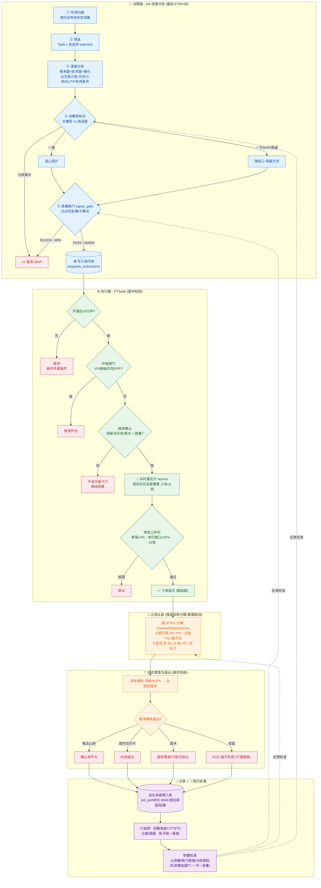

# FTSeek-US 自动交易流程图

> 双脑架构:**决策脑(DA 深度分析)** 负责选股与出计划,**执行脑(FTSeek)** 负责下单与风控,
> 通过 `playbook_instructions` 指令库交接;**复盘回归** 持续校准参数(先走模拟盘门)。
> 度量统一用 `pnl_pct`;纪律:数据说话、一次一变量、风控硬约束、全程可回滚。
>
> ⚠️ **本文定位**:上方**流程图=结构/逻辑链路的 SSOT(手维护)**;下方
> **「实时参数快照」块由 `scripts/gen_trading_ssot.py` 自动生成**(从真实配置/代码抽取、带出处)。
> 流程图内的数字仅为**示意**,具体数值一律以自动块为准 —— 配置改了跑一次生成器即刷新,不会过期。

## 图例速读

| 颜色 | 环节 | 一句话 |
|---|---|---|
| 🔵 蓝 | 决策脑 DA | 选股 → 出计划 → 双模型辩论 → 质量闸门 → 写指令库 |
| 🟢 绿 | 执行脑 FTSeek | 开盘门 → 环境门 → 突破触发 → 重定价 → 资金护栏 → 下单 |
| 🟠 橙 | 止损止盈 | 波动率分桶,止损 2~5%,方向不变式保证 |
| 🔴 红 | 退出/拦截 | 保本棘轮 + 硬止损/时间/盘末/收盘强平 |
| 🟣 紫 | 记录与回归 | 全程留痕 → IC/复盘/影子 → 校准参数(反馈回闸门/止损/辩论) |

> **闭环**:紫色的"参数校准"用真实 `pnl_pct` 反哺蓝色的质量闸门、辩论规则和橙色的止损桶——
> 系统持续自我校准,但每次只动一个变量、先影子验证、再切实盘。

---

## 实时参数快照

<!-- AUTOGEN:params:start -->
> 🤖 自动生成 · 请勿手改此块 · 生成时间 2026-07-14 21:22 ET · commit `abe2f5fa`
> 数值均从真实配置/代码抽取, 带出处; 结构(上方流程图)才是手维护的 SSOT。

#### 执行护栏 (Execution Guardrails)
| 参数 | 值 | 出处 | 说明 |
|---|---|---|---|
| 开盘后缓冲 | 5 分钟 | pipeline.py:2111 | 避开开盘噪声, 之后才执行 |
| max_position_pct | 4% | pipeline.py:2337 代码默认 | 单笔仓位上限(占基准资金) |
| daily_notional_cap_pct | 20% | pipeline.py:2194 代码默认 | 单日总敞口上限 |
| max_daily_positions | 5笔 | pipeline.py:2196 代码默认 | 单日最多开仓数 |
| risk_pct | 0.5% | pipeline.py:2336 代码默认 | 单笔风险预算(占基准资金) |
| min_confidence | 60 | pipeline.py:2339 代码默认 | 信心基准(仓位加权中性点) |

#### 止损止盈波动率桶 (playbook_horizon.yaml::vol_buckets)
| 桶 | ATR%上限 | SL范围 | TP倍数 | 最长持仓 |
|---|---|---|---|---|
| short/low | ATR<0.015 | 2.0~2.5% | 2.0 | 6h |
| short/medium | ATR<0.035 | 2.5~4.5% | 1.8 | 4h |
| short/high | ATR<0.08 | 3.5~5.0% | 1.5 | 2h |
| short/extreme | ATR<999.0 | 3.5~5.0% | 1.5 | 1h |
| long/low | ATR<0.015 | 1.5~3.0% | 2.5 | 24h |
| long/medium | ATR<0.035 | 2.5~5.0% | 2.0 | 16h |
| long/high | ATR<999.0 | 3.5~5.0% | 1.8 | 8h |

#### 退出规则 factor_exit_rules (playbook_horizon.yaml)
| 因子 | 保本触发 | 时间退出 | trailing |
|---|---|---|---|
| default | 1.0% | 4.0h | on |
| insider_cluster_buy | 0.5% | 禁用 | on |
| macd_golden_cross | 1.0% | 6h | on |
| above_ma20 | 1.0% | 6h | on |
| news_positive | 0.5% | 4h | on |
| volume_expansion | 0.5% | 0.5h | off |
| rsi_oversold | 0.5% | 0.5h | off |
| pe_below_industry | 0.5% | 0.5h | off |
| above_ma50 | 1.0% | 6h | on |
| ma_golden_cross | 1.0% | 6h | on |
| bollinger_upper | 1.0% | 4h | on |
| bollinger_squeeze | 1.0% | 6h | on |
| near_52w_high | 1.0% | 4h | on |
| insider_net_buy | 0.5% | 禁用 | on |
| revenue_growth_high | 0.5% | 禁用 | on |
| roe_high | 0.5% | 禁用 | on |
| earnings_beat_streak | 0.5% | 8h | on |
| post_earnings_momentum | 0.5% | 8h | on |
| sentiment_bullish | 0.5% | 4h | on |
| below_ma20 | 0.5% | 1.0h | off |
| below_ma50 | 0.5% | 1.0h | off |
| ma_dead_cross | 0.5% | 1.0h | off |
| macd_dead_cross | 0.5% | 1.0h | off |
| bollinger_lower | 0.5% | 0.5h | off |
| near_52w_low | 0.5% | 0.5h | off |
| rsi_overbought | 0.5% | 0.5h | off |
| rsi_neutral_low | 0.5% | 1.0h | off |
| news_negative | 0.5% | 0.5h | off |
| sentiment_bearish | 0.5% | 0.5h | off |
| insider_net_sell | 0.5% | 1.0h | off |
| pe_above_industry | 0.5% | 1.0h | off |
| volume_contraction | 0.5% | 1.0h | off |
| earnings_approaching | 0.5% | 1.0h | off |

#### 调度与指令来源状态 (cron / hermes)
| 作业 | 计划(cron/机器时钟=北京) | 状态 | 出处 |
|---|---|---|---|
| deep-stock-analysis 每日盘前扫描+分析 | 0 18 * * 1-5 | ✅启用 (scheduled) | jobs.json |
| deep-analysis 盘后复盘+记忆更新 | 0 5 * * 2-6 | ✅启用 (scheduled) | jobs.json |
| deep-analysis-bridge-generation | 0 4 * * 2-6 | ⏸暂停 (paused) | jobs.json |
| sltp_shadow_pnl | 0 6 * * 2-6 | crontab | crontab -l |
| da_chain_health | 5 6 * * 2-6 | crontab | crontab -l |
| da_bridge_dingtalk | 30 20 * * 1-5 | crontab | crontab -l |
| divergence_arbitration | 8 6 * * 2-6 | crontab | crontab -l |
| shadow_board | 15 6 * * 2-6 | crontab | crontab -l |

#### 总开关与时间框架 (unified_config.yaml / playbook_horizon.yaml)
| 参数 | 值 | 出处 | 说明 |
|---|---|---|---|
| auto_execute | True | unified_config.yaml::playbook | 自动执行总开关 |
| fallback_when_no_bridge | technical | unified_config.yaml::playbook | 无bridge时兜底策略 |
| short_horizon.rr_ratio | 999 (999=禁TP靠EOD) | playbook_horizon.yaml | 盈亏比 |
| short_horizon.max_hold_days | 1 | playbook_horizon.yaml | 最长持仓天数 |
| long_horizon.rr_ratio | 2.0 | playbook_horizon.yaml | 盈亏比 |
| long_horizon.max_hold_days | 3 | playbook_horizon.yaml | 最长持仓天数 |

<!-- AUTOGEN:params:end -->
