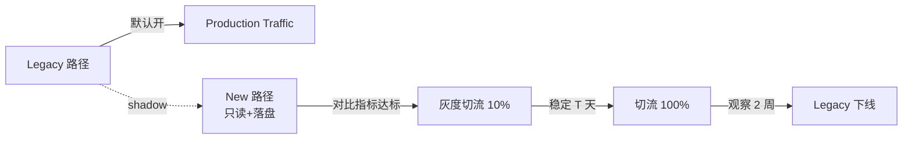
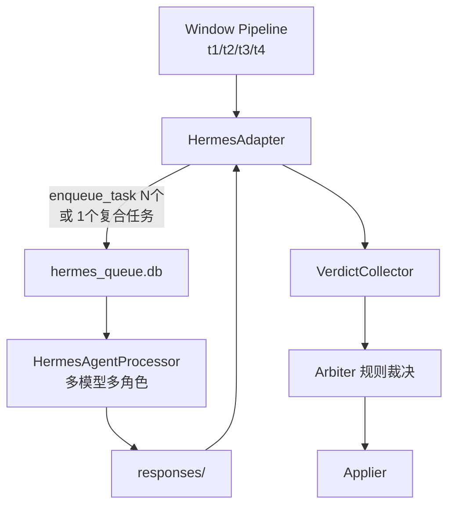
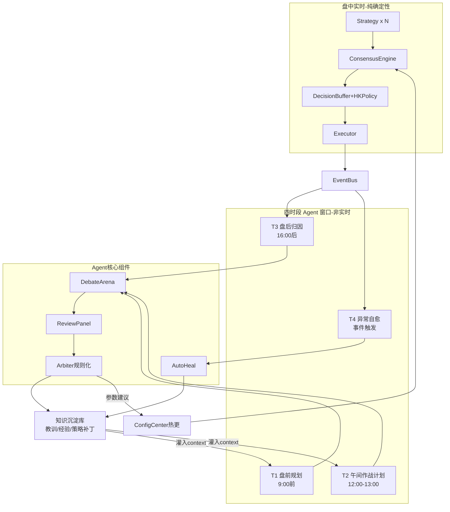

# 港股Agent架构收敛整治（四时段 + 融合稳定版）

## 核心澄清

- **盘中路径零 LLM/Agent**：技术面策略 + ConsensusEngine 纯确定性决策，保证秒级响应与可回测。
- **Agent 活跃于四个非实时窗口**：盘前规划、午间休市（上午复盘+下午作战计划）、盘后归因、异常触发自愈。
- **沉淀闭环**：辩论确认后的复盘/归因/教训落入知识库，回灌到下一时段的 Agent context。
- **自愈闭环**：明确异常由 AutoHeal Agent 自动修复并记录，无法自愈则升级人工。
- **工程约束**：功能模块化 + 模块间低耦合 + 配置 SSOT 遵守现有 `unified_config.yaml`。
- **生产红线**：整个整治期内交易链路 7x12 持续可用，任何 Task 都能独立回滚。
- **LLM 唯一载体 = Hermes Agent 平台**：所有 LLM 调用一律封装为 Hermes 任务，交由 Hermes 做多任务分配与卍调；本系统只当"任务提交方 + 结果消费方"，禁止旁路直接调用 LLM SDK。

## Karpathy 原则落地清单

| 原则 | 在本项目的具体形态 |
|---|---|
| 简单 > 正确 > 快 | 不造跨市场抽象层；港股特性直接叫 `hk_policy`，不叫 `market_policy` |
| 端到端可复现 | 盘中回放从 tick 到订单必须 byte-for-byte 一致；Agent 层产物（计划/教训）不入回放序列，只入配置版本 |
| 数据/配置驱动 | 新 Agent = 加 YAML + Handler 类；新策略 = 加 YAML + 策略类；新修复模式 = 加 pattern 行 |
| 显式优于隐式 | 配置缺失/模型不可用/补丁未生效一律抛错+告警，禁止静默走默认值 |
| 观测先于优化 | 每个模块独立 logger namespace + Prom 指标前缀 + trace_id 贯穿一个窗口任务 |
| 小步快跑可回滚 | 每个 Task 绑定 `FTSEEK_FEAT_<X>_ENABLED` 开关 + 一条 `scripts/rollback_<X>.sh` |
| 一眼看穿调用链 | `tick -> strategy -> consensus -> hk_policy -> decision_buffer -> executor`，严禁在这 6 步之间插代理/协调器 |

## 生产红线（不可触碰）

整治期内**严禁改动**以下签名与行为：

- [ConsensusEngine.on_signal / on_consensus](file:///opt/ftseek/app/strategy/consensus_engine.py) 输入输出结构。
- [DecisionBuffer.submit / _drain](file:///opt/ftseek/app/decision_buffer.py) 入口协议。
- [TradeExecutor.execute](file:///opt/ftseek/app/trader/executor.py) 订单语义与富途 API 边界。
- 盘中数据管道 [data_subscriber.py](file:///opt/ftseek/app/data_subscriber.py) 的 quote/kline 回调路径。
- Hermes 接口契约：[agent_bridge.enqueue_task](file:///opt/ftseek/app/llm/agent_bridge.py) 的 `(request_type, payload, market)` 签名、[hermes_queue.db](file:///root/.hermes/ftseek/hermes_queue.db) 的 `agent_requests` 表结构、responses 目录格式。

以上五件套只允许**被动读配置**、**被动接收新字段**，任何需要修改它们签名的 Task 必须独立发布窗口并准备 shadow 对比。

## 融合与稳定策略（Strangler Fig）



**四道门，必须依序通过**：

1. **共存门**：新老并行跑，新模块只写 `data/shadow/` 目录，不影响生产。
2. **对比门**：连续 N 天新老输出 diff 在阈值内（`agent_verdict` 无分歧 > 95%、延时 < 500ms）。
3. **灰度门**：feature flag 按比例切流（10% -> 50% -> 100%），每次观察 2-3 个交易日。
4. **下线门**：100% 稳定 2 周后，老代码移入 `backups/`，保留 30 天。

**全局开关表**（都在 `config/unified_config.yaml:feature_flags` 下）：

| Flag | 默认 | 含义 |
|---|---|---|
| `agents.enabled` | false | Agent 层总开关，关闭后完全退回 Legacy |
| `agents.t1_premarket` | false | 盘前规划窗口 |
| `agents.t2_midday` | false | 午间作战计划窗口 |
| `agents.t3_eod` | false | 盘后归因窗口 |
| `agents.t4_selfheal` | false | 自愈 Agent（接管前先 shadow）|
| `agents.plan_applier_write` | false | 作战计划是否真的写 ConfigCenter（关闭时只落盘） |
| `hk_policy.unified` | false | 港股单点化策略启用 |
| `config.ssot_strict` | false | SSOT 一致性校验是否硬拦截启动 |

任何模块上线都遵循：**代码合并（flag=false） -> shadow 一周 -> 切 10% -> 切 100% -> 老码下线**。

## Hermes 作为 LLM 载体的架构约定

### 角色划分

- **Hermes Agent 平台**（外部服务 + 本地持久化队列）：负责模型调用、tool-calling、多角色辩论的内部协调、任务重试。
  - 队列 SSOT：[hermes_queue.db](file:///root/.hermes/ftseek/hermes_queue.db)、[responses/](file:///root/.hermes/ftseek/responses)。
  - 执行体：[HermesAgentProcessor](file:///opt/ftseek/app/llm/agent_processor.py) + [hermes_tools.py](file:///opt/ftseek/app/llm/hermes_tools.py)。
- **FTSeek 主系统**：仅作为 Hermes 的"任务提交方 + 结果消费方"。
  - 提交入口：[agent_bridge.enqueue_task](file:///opt/ftseek/app/llm/agent_bridge.py)。
  - 消费入口：轮询 responses / 监听队列完成事件。
- **禁止**：`app/agents/**` 任何模块直接 `import openai / dashscope / qwen_sdk`。只能通过 adapter 调 Hermes。

### 任务类型 SSOT（扩展现有 3 类为 4 个窗口）

| request_type | 触发窗口 | Hermes 内部角色编排 | 输出 |
|---|---|---|---|
| `battle_plan` | T1 盘前 | 宏观/技术/风险 三角色辩论 | daily_battle_plan.json |
| `midday_adjust` | T2 午间 | 多角色辩论 + reviewer 确认 | afternoon_plan.json |
| `eod_review` | T3 盘后 | 归因分析 + 教训提炼 | lessons entries |
| `self_heal_diagnose`（**新增**） | T4 异常事件 | 诊断模式匹配 + 修复建议 | repair plan |

每个任务类型在 `config/agents/<type>.yaml` 中定义 payload schema、角色列表、轮数、超时、输出 schema，不在代码中硬编码。

### 多任务分配的层次



- **辩论/多角色由 Hermes 侧负责**：首选提交一个复合任务（Hermes 内部编排多角色），避免本系统再做任务编排。
- **如 Hermes 不支持复合任务**：降级方案是 HermesAdapter 提交 N 个子任务 + 本地 VerdictCollector 按 `parent_rid` 聚合，但依然不做“模型轮次控制”。
- **Arbiter 留在本系统**：规则化裁决必须可审计、可回测，不交给 LLM。

### 目录结构

```
app/agents/
├── core/              # 内核
│   ├── protocol.py    # BaseAgent / AgentContext / AgentVerdict
│   ├── registry.py    # 插件化扫描+注册
│   ├── hermes_client.py   # Hermes 交互客户端（封装 agent_bridge）
│   └── container.py   # 轻量 DI 容器
├── windows/           # 四时段业务模块（平级，互不依赖）
│   ├── t1_premarket/
│   ├── t2_midday/
│   ├── t3_eod/
│   └── t4_selfheal/
├── primitives/        # 可复用原语（编排 Hermes 任务，不再直接调 LLM）
│   ├── task_builder.py    # 根据场景 YAML 构造 Hermes task payload
│   ├── verdict_collector.py # 聚合多子任务结果
│   └── arbiter.py     # 规则化裁决（本地确定性）
├── applier/           # 输出落地
│   ├── plan_applier.py
│   └── lessons_writer.py
└── adapters/          # 反腐层
    ├── hermes_adapter.py  # 与 Hermes 队列唯一交互出口
    ├── consensus_adapter.py
    ├── eventbus_adapter.py
    └── config_adapter.py
```

### 模块依赖矩阵（import-linter 强制）

| 调用方 | 允许依赖 | 禁止依赖 |
|---|---|---|
| windows/t* | core, primitives, applier, adapters | 其它 window、app.strategy、app.trader、app.risk 直接导入、app.llm 直接导入 |
| primitives | core | windows、applier、adapters、app.* |
| applier | core, adapters | windows、primitives |
| adapters | core + 外部模块（单向出口） | windows、primitives、applier |
| app.strategy / app.trader / app.risk | 无 | app.agents.* 全部 |
| app.agents.** | 禁止 `openai`、`dashscope`、`qwen_sdk` 等 LLM SDK | 只能通过 adapters.hermes_adapter 进出 |

### 通信规则（三种通道，其它禁止）

1. **显式方法调用**：仅限 core/primitives/applier 之间，通过 DI 容器注入实例。
2. **EventBus**：跨模块通知走 [app.core.domain_events](file:///opt/ftseek/app/core/domain_events.py)，事件 schema 定义在 `app/agents/core/events.py`。
3. **ConfigCenter**：参数/作战计划/知识条目通过 ConfigCenter 或专用 Store 持久化。
4. **禁止**：共享文件/共享数据库表作为模块间通信通道；禁止跨模块读内部 state。

### SSOT 分片方案（兼容 unified_config.yaml）

主文件 `config/unified_config.yaml` 保持 SSOT 地位，新增 `agents` 节点声明 Hermes 任务模板与开关：

```yaml
agents:
  enabled: true
  hermes:
    queue_db: ~/.hermes/ftseek/hermes_queue.db
    responses_dir: ~/.hermes/ftseek/responses
    submit_timeout_sec: 5        # enqueue 本身的超时
    poll_interval_sec: 2
    task_deadlines:              # 各窗口任务的总完成截止
      battle_plan: 300
      midday_adjust: 180         # 12:55 前必须回结果
      eod_review: 600
      self_heal_diagnose: 120
  config_include:
    - config/agents/t1_premarket.yaml
    - config/agents/t2_midday.yaml
    - config/agents/t3_eod.yaml
    - config/agents/t4_selfheal.yaml
  arbiter_rules:
    standard: { veto_conf_threshold: 0.7, quorum: majority }
  knowledge_store:
    lessons_db: data/hk_lessons.db
```

子文件 `config/agents/<type>.yaml` 声明任务 payload schema、角色、轮数、Hermes tool 调用策略、`arbiter.rules_ref`、`output.{target, whitelist_fields}`。模型选择本身由 Hermes 侧 config 控制，FTSeek 不再维护模型池。

## 现状问题（代码事实）

- 三条决策路径职责重叠：[ConsensusEngine](file:///opt/ftseek/app/strategy/consensus_engine.py)、[LLMMarketAnalyst](file:///opt/ftseek/app/ai/llm_market_analyst.py)、[HarnessPilot](file:///opt/ftseek/app/harness_pilot.py) + [HermesAgentProcessor](file:///opt/ftseek/app/llm/agent_processor.py) 都能影响决策，边界模糊。
- Agent 场景常量化：[app/agents/scenarios/*.py](file:///opt/ftseek/app/agents/scenarios) 中模型、prompt、角色、轮次全部写死。
- 新旧并存：[debate_orchestrator.py](file:///opt/ftseek/app/agents/debate) 与 [registry.py](file:///opt/ftseek/app/agents/registry.py) 并行；[news_push/](file:///opt/ftseek/app/news_push) 与 [news_v2/](file:///opt/ftseek/app/news_v2) 并行。
- 港股特性散落三层：[hk_specific.py](file:///opt/ftseek/app/strategy)、HK Adapter、[executor.py](file:///opt/ftseek/app/trader/executor.py) 重复检查。
- 自愈能力已有雏形（[app/self_healing/](file:///opt/ftseek/app/self_healing)、autoheal/）但未与 Agent 层打通。
- 死代码嫌疑：[app/deep_review/](file:///opt/ftseek/app/deep_review)、[app/autoresearch/](file:///opt/ftseek/app/autoresearch)、[app/profit/](file:///opt/ftseek/app/profit)、[app/executor/](file:///opt/ftseek/app/executor) 无主链路入口。

## 目标架构



核心原则：
- **盘中路径不允许 LLM 进入**：ConsensusEngine 产出即最终决策，经 HKPolicy + DecisionBuffer 直下 Executor。
- **Agent 输出物是"参数/计划/教训"而非"订单"**：午间作战计划=权重/观察名单/熔断阈值的建议，通过 ConfigCenter 热加载，不直接下单。
- **一切 Agent/模型/场景/prompt 走 YAML**：新增场景 = 加 YAML + 加 Handler 类。
- **沉淀与自愈是 Agent 层的正式产出**：知识库既是输出也是下次 Agent 的输入。

## 时段职责矩阵

| 时段 | 触发 | Agent 任务 | 输出物 | 落地方式 |
|---|---|---|---|---|
| T1 盘前规划 | 8:30 cron | 多模型分析夜间新闻/美股/ADR，输出关注名单、权重预设 | `daily_battle_plan.json` + 配置补丁 | ConfigCenter 热更 + 钉钉推送 |
| T2 午间作战计划 | 12:00 cron | 基于上午行情+成交+新闻进行辩论+审阅，确认下午是否调整仓位/风险阈值/观察名单 | `afternoon_plan.json` + 配置补丁 | 13:00 前推 ConfigCenter，强制在 13:01 开盘生效 |
| T3 盘后归因 | 16:30 cron | 对当日成交做归因辩论，产出教训 | 知识库条目 + 参数调整建议 | 写入 `hk_lessons.db` + 周五汇总进 meta |
| T4 异常自愈 | EventBus 事件 | 检测异常模式 -> 匹配/生成修复策略 -> 执行或告警 | 修复操作日志 + 知识库条目 | 调用 self_healing.engine 执行，失败则升级钉钉 |

## Task 0  DI 容器与依赖约束

- 新增 [app/agents/core/container.py](file:///opt/ftseek/app/agents/core/container.py)：轻量 DI 容器（可选 `punq` 或手写 200 行），注册 LLMClient、KnowledgeStore、EventBus、ConfigCenter、HKPolicy 适配器等。
- 禁用 Agent 层中的全局单例函数：`get_risk_manager()` / `get_llm_client()` / `get_registry()` 在 `app/agents/` 下一律替换为构造函数注入。
- 新增 `pyproject.toml` 中的 import-linter 合同，或 CI 检查脚本 `scripts/check_agent_imports.py`：强制模块依赖矩阵。
- 容器在 [main.py](file:///opt/ftseek/app/main.py) 启动阶段装配，与现有服务注入协同。

## Task 1  Agent 协议与注册中心

- 新增 [app/agents/protocol.py](file:///opt/ftseek/app/agents/protocol.py)：`BaseAgent`、`AgentContext`、`AgentVerdict`。
- 重写 [app/agents/registry.py](file:///opt/ftseek/app/agents/registry.py)：从 `config/agents/*.yaml` 扫描注册；支持 entry-point `module:ClassName`；保留运行时 `register()`。
- 废弃 `ALL_SCENARIOS` 硬编码，改为 `ScenarioLoader`。

## Task 2  场景与模型配置化（SSOT 分片）

- 在 [config/unified_config.yaml](file:///opt/ftseek/config/unified_config.yaml) 新增 `agents` 节点（见上文模板），作为模型池、规则集、include 列表的 SSOT。
- 新增 `config/agents/` 目录承载场景文件，只引用主文件的 key：
  - `t1_premarket.yaml`、`t2_midday.yaml`、`t3_eod_attribution.yaml`、`t4_selfheal.yaml`、`meta_weekly.yaml`。
- 场景 YAML 字段：`agents[*].{role, model_ref, prompt_template, timeout_override?}`、`execution.{mode, rounds, quorum}`、`arbiter.rules_ref`、`output.{target, whitelist_fields}`。
- Prompt 模板独立 `config/agents/prompts/*.jinja`，避免多行字符串污染 YAML。
- [ConfigCenter](file:///opt/ftseek/config/config_center.py) 新增 `include` 机制与引用解析；启动时做一致性校验（model_ref 必须能在模型池中找到）。
- 模型名从 [agents/scenarios/debate.py](file:///opt/ftseek/app/agents/scenarios) 硬编码迁出；[BaseLLMService](file:///opt/ftseek/app/agents/base.py) 默认模型走 ConfigCenter。

## Task 3  HermesAdapter + VerdictCollector + 规则化 Arbiter

- 新增 [app/agents/adapters/hermes_adapter.py](file:///opt/ftseek/app/agents/adapters/hermes_adapter.py)：唯一与 Hermes 交互的出口。
  - `submit(task_type, payload, market, deadline) -> request_id`：封装 [agent_bridge.enqueue_task](file:///opt/ftseek/app/llm/agent_bridge.py)；
  - `await_result(request_id, deadline) -> TaskResult`：按 `poll_interval_sec` 轮询 responses 目录；
  - 所有超时/失败抛显式异常，禁默认值。
- 新增 [app/agents/primitives/task_builder.py](file:///opt/ftseek/app/agents/primitives/task_builder.py)：根据场景 YAML 构造 payload；首选“一个复合任务”由 Hermes 内部编排多角色。
- 新增 [app/agents/primitives/verdict_collector.py](file:///opt/ftseek/app/agents/primitives/verdict_collector.py)：在降级为 N 个子任务时，按 `parent_rid` 聚合多个 response 为统一 `AgentVerdict` 列表。
- 新增 [app/agents/primitives/arbiter.py](file:///opt/ftseek/app/agents/primitives/arbiter.py)：**显式规则**裁决，非 LLM：
  - 任一 reviewer `veto=true AND confidence>0.7` -> 升级人工敲木确认；
  - 多数同向 -> 采纳为作战计划；
  - 分歧大 -> 保守方案（维持现状 + 观察名单）。
- Arena/Review/Arbiter **不进入盘中 `_on_consensus` 回调**；仅被 T1/T2/T3 调度器调用。
- 现有 [pipeline/midday_plan_refresher.py](file:///opt/ftseek/app/pipeline/midday_plan_refresher.py)、[pipeline/premarket_scheduler.py](file:///opt/ftseek/app/pipeline/premarket_scheduler.py)、[review/hk_eod_review.py](file:///opt/ftseek/app/review/hk_eod_review.py) 中直调 `bridge.enqueue_task` 的点，改为调用 `hermes_adapter.submit`（向下兼容）。

## Task 4  四时段窗口模块与调度器

- 每个 window 作为独立 package，包含 `pipeline.py`（编排 primitives）+ `context_builder.py`（组装输入）+ `output_handler.py`（交给 applier），互不 import 对方。
- 新增 [app/agents/core/scheduler.py](file:///opt/ftseek/app/agents/core/scheduler.py)：负责 cron 触发与事件订阅，window 实例由 DI 容器注入：
  - T1/T2/T3 走 Arena+Review+Arbiter 流水线；
  - T4 走 AutoHeal 流水线。
- 午间任务单独约束：**必须在 12:55 前输出 FinalVerdict**，否则回退"维持现状"。
- 任务队列 `hermes_queue.db` 增加 `window`（t1/t2/t3/t4）与 `market` 字段。
- [HarnessPilot](file:///opt/ftseek/app/harness_pilot.py) 保留为宿主线程，不再直接持有业务逻辑。

## Task 5  作战计划落地为配置补丁

- 新增 `app/agents/plan_applier.py`：把 T1/T2 的 FinalVerdict 转为 ConfigCenter 的增量补丁。
  - 仅允许修改白名单字段：`strategy.weights`、`risk.max_position_pct`、`watchlist.active`、`consensus.threshold`。
  - 每次补丁带版本号 + Arbiter 引用，支持一键回滚。
- [ConsensusEngine](file:///opt/ftseek/app/strategy/consensus_engine.py) 保持"被动接收配置"，不感知补丁来源。

## Task 6  知识沉淀闭环

- 新增 [app/knowledge/lessons_store.py](file:///opt/ftseek/app/knowledge/lessons_store.py)：在现有 `data/hk_lessons.db` 基础上封装：
  - 写入：T3 盘后归因确认后的教训条目（entity、pattern、evidence、recommendation）。
  - 读取：T1/T2 启动时按标的/市场状态召回最近 N 条相关教训，注入 prompt context。
- 周度 `meta_weekly.yaml` 对教训去重/聚合/升级为"策略补丁候选"。

## Task 7  AutoHeal 与 Agent 层打通

- 现有 [app/self_healing/engine.py](file:///opt/ftseek/app/self_healing/engine.py) + autoheal/ 目录保持执行层。
- 新增 `app/agents/autoheal_agent.py`：作为 Agent 侧入口，订阅 EventBus 异常事件（`POSITION_DRIFT`、`RISK_BREACH`、`OPEND_DISCONNECT`、`SIGNAL_STARVATION` 等）：
  1. 匹配 `data/self_healing_patterns.json` 已知模式 -> 直接调用 engine 自愈；
  2. 未知模式 -> 启动诊断辩论（降配模型，短超时），产修复脚本建议；
  3. 修复后写 `self_healing_history.json` + 知识库。
- 明确"可自愈"白名单，白名单外一律升级人工钉钉。

## Task 8  港股特性单点化

- 新增 [app/strategy/hk_policy.py](file:///opt/ftseek/app/strategy)：合并 [hk_specific.py](file:///opt/ftseek/app/strategy)、HK Adapter、Executor 中分散的规则。
- `HKPolicy.check(signal) -> PolicyDecision` 在 DecisionBuffer 入口统一调用。
- Tier 仓位百分比迁入 `config/unified_config.yaml:hk_policy.tier_position`。

## Task 9  新旧并存清理

- 删除 [debate_orchestrator.py](file:///opt/ftseek/app/agents/debate)，[debate_trigger.py](file:///opt/ftseek/app/agents/debate) 改调 Arena。
- [news_push/](file:///opt/ftseek/app/news_push) 与 [news_v2/](file:///opt/ftseek/app/news_v2) 二选一后归档。
- 审 crontab 后再动 [deep_review/](file:///opt/ftseek/app/deep_review)、[autoresearch/](file:///opt/ftseek/app/autoresearch)、[profit/](file:///opt/ftseek/app/profit)、[executor/](file:///opt/ftseek/app/executor)；离线脚本挪到 `scripts/research/`。
- ADX 重复计算以 [ConsensusEngine](file:///opt/ftseek/app/strategy/consensus_engine.py) 为 SSOT，[data_subscriber.py](file:///opt/ftseek/app/data_subscriber.py) 不再重算。

## Task 10  配置源 SSOT 收敛

- `config/unified_config.yaml` 为唯一 SSOT；`.bak*` 归档。
- `config/agents/*.yaml` 由 ConfigCenter 托管，热重载。
- [main.py](file:///opt/ftseek/app/main.py) 启动时对 "代码 fallback vs config" 做硬性一致性校验，不一致则启动失败。

## Task 11  验收与回归

- **静态门禁**：
  - `scripts/check_agent_imports.py` 或 import-linter：依赖矩阵违规则 CI 失败；
  - ConfigCenter 启动校验：`model_ref`/`rules_ref` 必须能解析，否则拒绝启动；
  - 检查全局单例函数在 `app/agents/` 下的使用，存在即失败。
- 单元：`tests/agents/test_arena.py`、`test_arbiter_rules.py`、`test_plan_applier.py`、`test_lessons_store.py`、`test_autoheal_agent.py`、`test_container_wiring.py`、`test_config_include.py`.
- 集成：
  - 回放一日历史行情 + 模拟四时段触发，验证 T2 作战计划能在 13:00 前生效。
  - 注入已知异常模式（OpenD 断连、持仓漂移），验证 AutoHeal 闭环。
- 回测：[run_confluence_backtest.py](file:///opt/ftseek/backtest) 确认盘中主决策 P&L 不回退（Agent 层不应影响回测路径）。
- 灰度：
  - 环境开关 `FTSEEK_AGENT_T1/T2/T3/T4_ENABLED` 分窗口启停；
  - T2 先空跑一周（只落盘 transcript 不生成补丁），人工审阅质量后再启用 plan_applier；
  - T4 白名单外的自愈动作先默认"建议不执行"。

## 实施分期

**第一期（治乱，3-5 天，零架构风险）**
- Task 9（清理并存与死代码，审 crontab）
- Task 10（SSOT 收敛：归一 unified_config.yaml，准备 include 机制）
- 第一期完成即可见"目录变瘦、启动更稳"。

**第二期（搭骨，1-2 周）**
- Task 0（DI 容器 + import 门禁）
- Task 1-2（协议 + SSOT 分片配置）
- Task 3（Arena/Review/规则化 Arbiter）
- Task 4（四时段模块 + 调度器）
- Task 6（知识沉淀）
- 第二期完成：T1/T3 跑通，T2 空跑，模块依赖矩阵有 CI 护栏。

**第三期（闭环，3-5 天）**
- Task 5（plan_applier）
- Task 7（AutoHeal 打通）
- T2 正式启用 + T4 白名单启用。

**第四期（风险项，独立灰度）**
- Task 8（港股特性单点化）—— 只在前三期稳定后启动，单独一次发布窗口。

## 不在本计划内

- 盘中交易路径不引入任何 LLM/Agent（确定性是红线）。
- 不改 ConsensusEngine 内核签名；它只被动读配置。
- 不引入新 LLM 供应商/新模型。
- 不改回测引擎内部实现。
- 不改造富途 API 层。
- 不替换现有 self_healing.engine 执行层，只在其上加 Agent 决策入口。

## 每个 Task 的交付闭环（Karpathy 式小闭环）

每个 Task 完成时**必须同时交付**四件套，缺一不可：

1. **Feature Flag**：`config/unified_config.yaml:feature_flags.<task>` 默认 false。
2. **可观测件**：独立 logger namespace `ftseek.agents.<module>`、Prom 指标前缀、trace_id 贯穿。
3. **回滚脚本**：`scripts/rollback_<task>.sh`——一条命令关 flag + 恢复配置（如需）。
4. **验收脚本**：`scripts/verify_<task>.sh`——检查 shadow 目录输出或 diff 报告。

## 生产观测基线

新模块上线前，以下指标**必须有仪表盘 + 告警阈值**：

- 每个窗口任务：运行成功率、P95 耗时、LLM 调用失败率、仲裁结果分布。
- plan_applier：作战计划生效趋统/回滚次数/白名单外字段尝试写入（应为 0）。
- autoheal：异常捕获量/自愈成功率/升级人工次数。
- lessons_store：写入条目数、回灌命中率（T1/T2 用上了多少条）。
- SSOT 一致性：`config.ssot_strict` 模式下的违规次数（目标 0）。
- **Hermes 队列健康**（新增）：队列积压深度、任务 P95 从提交到 response 的耗时、超时率、每窗口 request_type 成功率、错误分布。

代码位置建议复用现有 [app/monitoring/](file:///opt/ftseek/app/monitoring) 框架，避免重复造轮。

## 回滚手册（按 Task）

| Task | 一转回滚动作 | 影响范围 |
|---|---|---|
| Task 0（DI容器） | `FEAT_DI_CONTAINER=false` + 重启 | Agent 层回退旧单例注入 |
| Task 1-2（协议+配置） | `agents.enabled=false` | 场景退回旧硬编码版 |
| Task 3（Arena/Arbiter） | `agents.t*.enabled=false` | 窗口任务不运行，日报/周报退回 Legacy 脚本 |
| Task 4（调度器） | 取消 crontab 条目 | 任务不触发 |
| Task 5（plan_applier） | `agents.plan_applier_write=false` | 计划只落盘不结构性影响生产 |
| Task 6（知识库） | 关闭回灌开关 | Agent prompt 不再注入教训 |
| Task 7（AutoHeal） | `agents.t4_selfheal=false` | 退回纯人工/旧 autoheal 脚本 |
| Task 8（hk_policy） | `hk_policy.unified=false` | 退回旧三层检查（旧代码保留 shim） |
| Task 9（清理） | 从 `backups/` 还原 | 30 天内可回滚 |
| Task 10（SSOT严格模式） | `config.ssot_strict=false` | 退回仅日志提示模式 |

